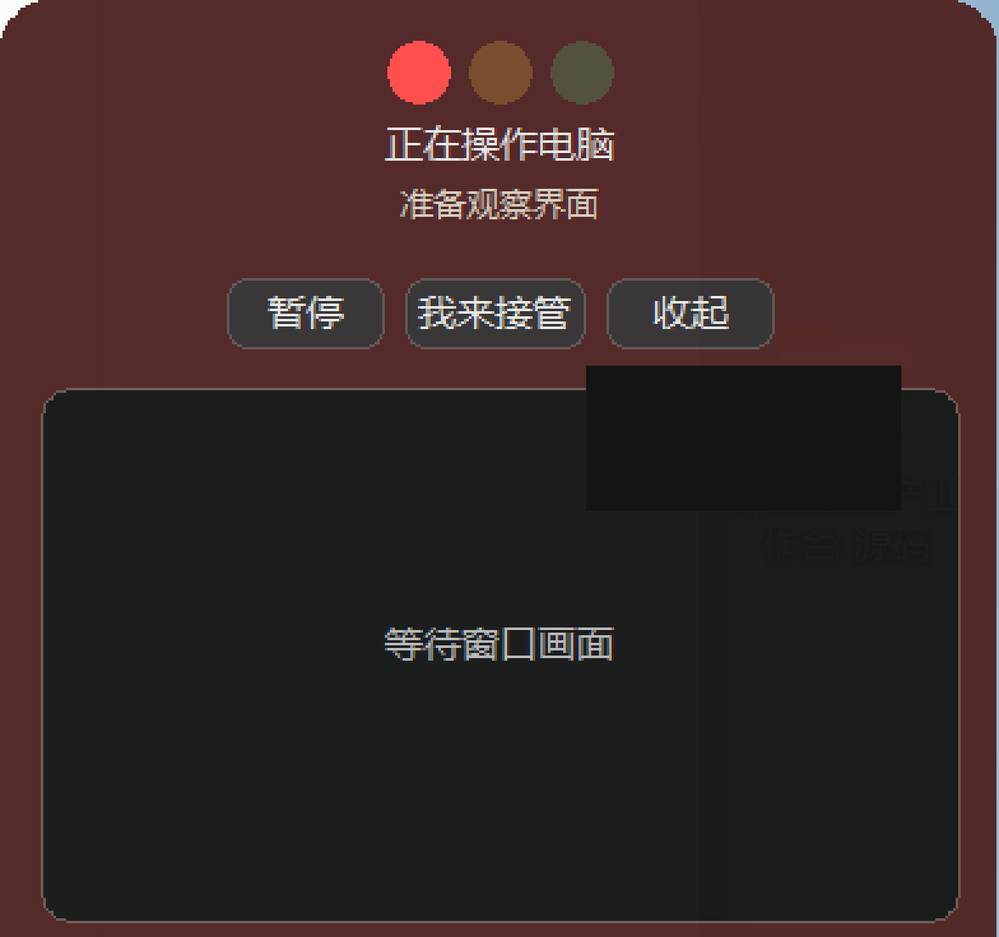
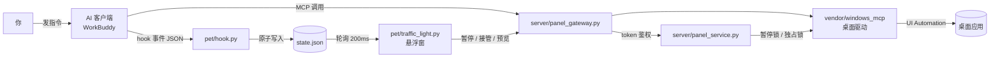

# Desktop Control Traffic Light

**给 AI 桌面代理一盏看得见的灯，和一只随时能按的刹车。**

AI 在替你操作电脑时，右下角有盏小灯告诉你它在干嘛；点一下就能暂停，再点一下把键盘还给你。
恢复必须由你在原任务里明确说「继续」——别的任何操作都不算。

> 适配 Windows 10/11 + Python 3.12。桌面悬浮窗用 tkinter，控制服务用 FastAPI，
> 底层驱动是 [Windows-MCP](https://github.com/CursorTouch/Windows-MCP) 0.8.5（已内含修复）。



---

## 目录 / Contents

- [它解决什么问题](#它解决什么问题)
- [两半，一套系统](#两半一套系统)
- [三种灯的含义](#三种灯的含义)
- [架构](#架构)
- [快速开始](#快速开始)
- [配置项](#配置项)
- [工具清单](#工具清单)
- [安全模型](#安全模型)
- [已知限制](#已知限制)
- [目录结构](#目录结构)
- [许可](#许可)

---

## 它解决什么问题

桌面自动化（Computer Use、桌面 MCP、RPA）默认是个黑盒：

| 问题 | 常见现状 | 本项目的做法 |
|---|---|---|
| **看不见** | AI 静默切窗口、点击、输入，你不知道进行到哪一步 | 三色灯 + 当前步骤文案 + 按需展开的实时画面 |
| **停不下** | 想中止只能杀进程，或者关掉整个客户端 | 全局暂停热键 / 按钮暂停，暂停即释放被按住的按键 |
| **恢复太随意** | 一句无关的闲聊就可能让 AI 继续动你的键盘 | 暂停是「锁定」状态，只有原任务里明确说「继续」才解除 |
| **并发打架** | 两个任务同时抢鼠标键盘，操作互相盖掉 | 电脑操作单任务独占锁，其他任务照常做自己的非电脑工作 |
| **无法回溯** | 做完不知道它到底点了什么 | 每步通过 `TaskProgress` 上报，红绿灯归档到会话状态 |

**它不是**：远程控制软件、录屏工具、自动点击器。它只给桌面代理加一层「可见 + 可中止」的壳。

---

## 两半，一套系统

| 模块 | 位置 | 职责 |
|---|---|---|
| **桌宠红绿灯** | `pet/` | tkinter 悬浮窗。显示灯色，展开后提供暂停 / 接管 / 画面预览。无控制台、真圆角、可拖动、位置记忆 |
| **控制服务** | `server/` | 本地 HTTP 服务（`127.0.0.1:18765`）。管暂停锁、任务生命周期、独占锁、截图与状态聚合。带 token 鉴权 |
| **桌面驱动** | `vendor/windows_mcp/` | 上游 Windows-MCP 0.8.5 + 本仓库移植的 0.8.6–0.8.8 修复 |

两者通过本地 HTTP + 启动时随机生成的 token 通信，**不经过任何外部网络**。

---

## 三种灯的含义

| 灯 | 文案 | 什么时候亮 | 判据 |
|:--:|---|---|---|
| 🔴 红 | 干活中 | 有任务在跑（1 个还是 N 个都一样） | `UserPromptSubmit` / `PermissionRequest` |
| 🟡 黄 | 等你一下 | **只在两种情况下亮** | ① 真弹出了权限确认框或 MCP 要你输入 ② 红灯静默 5 分钟（卡住了） |
| 🟢 绿 | 本轮结束 | 当前所有进行中的轮次都已结束 | `Stop` / `SessionEnd` |
| 🟠 橙闪 | 出错了 | 本轮因 API 错误中断 | `StopFailure` |
| ⚫ 全灭 | — | 没有进行中的任务 | — |

**设计要点**：绿灯只表示「这一轮结束了」，**不代表结果已验证成功**。工具调用成功 ≠ 任务完成，
两者刻意区分开，避免给你虚假的安心感。

> ⚠️ 踩过的坑：`PermissionRequest` 每次工具调用都会发（实测 2 分钟 16 次），
> 早期用它点黄灯导致「明明在干活却显示在等你」。现在它点亮**红灯**——它恰恰证明"我在跑"。
> `Notification(idle_prompt)` 是固定的 60 秒定时器，同样不点黄灯，只作为排查探针。

---

## 架构



**关键设计**：红绿灯只负责**显示和干预**，实际执行始终由当前 AI 任务驱动。
灯挂了不影响任务；灯活着也篡改不了任务内容。

### 暂停语义（这是本项目最核心的契约）

```
运行中 ──[暂停按钮 / Ctrl+Alt+F12 / 接管]──► 已暂停（锁定）
                                                 │
                                    只有「原任务里明确说继续」
                                                 ▼
                                            重新观察界面 ──► 运行中
```

- 暂停会：阻止后续所有电脑输入、让旧观察和排队输入失效、**释放本服务按住的按键**
- 暂停**不会**：被普通闲聊、打开详情、点「回任务」、重连连接器解除
- 恢复后必须重新 `Snapshot`，核对哪些操作已发生，避免重复输入或重复发送

---

## 快速开始

### 前置条件

| 项目 | 要求 |
|---|---|
| 系统 | Windows 10 / 11 |
| Python | **3.12**（推荐；3.13 的部分发行版不带 tkinter，会导致桌宠静默启动失败） |
| 客户端 | 支持 hook 事件 + MCP 的 AI 客户端（本文以 WorkBuddy 为例） |
| 权限 | 普通用户即可；操作管理员窗口需要对应权限 |

### 1. 取代码

```powershell
git clone https://github.com/1538105578lpl-ux/desktop-control-traffic-light.git
cd desktop-control-traffic-light
```

### 2. 建环境

```powershell
py -3.12 -m venv .venv
.\.venv\Scripts\activate
pip install -r requirements.txt
```

> `vendor/windows_mcp/` 已内含上游源码，**不要**再 `pip install windows-mcp`，
> 否则会装成不带修复的原版并产生版本冲突。

### 3. 自检

```powershell
python -m unittest discover -s tests
```

正常应看到 —— 控制面板 / 任务生命周期 / 可靠性三组共 **48 项通过**（`OK`）。
测试全用 mock，不会真的动你的键鼠。

### 4. 注册 MCP

```powershell
.\install.ps1
```

脚本会：
1. 备份 `~/.workbuddy/mcp.json` 到 `~/.workbuddy/backups/`
2. 写入 `windows-mcp` 条目（指向本仓库 `server/launcher.py serve`）
3. 把 `skills/windows-desktop-control/SKILL.md` 复制到 `~/.workbuddy/skills/`
4. **不动**配置文件里的其他 MCP 条目

### 5. 装 hook（点亮灯）

```powershell
python pet\install_hooks.py
```

同样先备份 `settings.json`，然后**增量合并**到 `hooks` 节点——
不会覆盖你其他工具注册的 hook。

### 6. 启动桌宠

```powershell
pythonw pet\launch_pet.pyw
```

想开机自动出现：

```powershell
python pet\manage_watchdog.py install
```

看门狗（`pet/watchdog.pyw`）每 1.5 秒轮询一次「客户端在跑 + 灯不在」→ 拉起灯。
它的状态文件在 `pet/watchdog_heartbeat.txt`，卸载用 `manage_watchdog.py uninstall`。

---

## 配置项

全部通过环境变量覆盖，无需改代码：

| 变量 | 作用 | 默认 |
|---|---|---|
| `CONTROL_ROOT` | 控制服务目录（`pet/` 找 `connection.json` 用） | 自动定位到 `../server` |
| `PET_PYTHONW` | 指定带 tkinter 的 `pythonw.exe` | 依次探测 `%LOCALAPPDATA%\Programs\Python\Python31x` |
| `PET_PYTHON` | `install_hooks.py` 写进 hook 的解释器 | 当前解释器 |
| `WORKBUDDY_HOME` | 客户端配置目录 | `~/.workbuddy` |
| `ANONYMIZED_TELEMETRY` | 上游遥测开关，本服务启动时强制 `false` | `false` |

端口固定 `18765`（`server/panel_common.py`）。改端口需同步改 `pet/desktop_bridge.py`。

---

## 工具清单

控制服务对上暴露 **26 个 MCP 工具**，相对上游的主要增量：

| 类别 | 工具 | 说明 |
|---|---|---|
| 任务生命周期 | `BeginDesktopTask` / `TaskProgress` / `EndDesktopTask` | 开始前登记、每步上报、结束核验 |
| 状态 | `ControlStatus` | 查暂停状态、当前任务、占用情况 |
| 窗口 | `WindowList` / `FocusWindow` / `ReadFocusedInput` | 枚举窗口、置顶并**验证**前台、读焦点控件 |
| 输入 | `Type` | 返回结构化校验结果（是否真正落进目标控件） |
| 观察 | `Snapshot` / `Screenshot` | 控件树 + 截图，可单独走 UIA 专用线程 |
| 常用 | `Click` / `Shortcut` / `Scroll` / `WaitFor` / `App` / `Clipboard` … | 沿用上游 |

**刻意不提供**：任意 PowerShell、任意可执行文件启动。
这两条是桌面 agent 最容易变成「远程代码执行入口」的地方，砍掉后仍可通过文件与 Office 工具完成绝大多数任务。

---

## 安全模型

完整版见 [SECURITY.md](SECURITY.md)，四条要点：

1. **只监听回环**：`127.0.0.1:18765`，不接受外部连接
2. **启动即换 token**：每次启动用 `secrets.token_urlsafe(32)` 生成，进程退出即失效，落盘在 `server/panel-runtime/connection.json`（已 gitignore）
3. **暂停是锁**：解除必须来自原任务的人类指令，AI 无法自行恢复
4. **零外部流量**：除可选的上游遥测（默认关）外，不发起任何网络请求

---

## 已知限制

诚实列出，避免踩坑：

- **只覆盖桌面客户端**。浏览器自动化、脚本、终端里的操作不受这套输入拦截器管，别把红绿灯当成"全局急停"
- **预览可能含遮挡内容**。窗口被别的程序盖住时，截图就是被遮住的画面
- **ProactorEventLoop 的 self-pipe 修复未生效**。上游 `install_selfpipe_guard` 只 patch `BaseSelectorEventLoop`，Windows 默认 `ProactorEventLoop` 下无效，该模块保留但不接入
- **单显示器坐标** 以主屏虚拟桌面为准，多屏混合 DPI 下坐标可能偏
- **无代码签名**。首次运行会被 SmartScreen 提示，属正常现象
- **不做提权**。操作管理员权限窗口需要服务自身以管理员身份运行

---

## 目录结构

```
desktop-control-traffic-light/
├── pet/                         # 桌面悬浮窗
│   ├── traffic_light.py         # 主窗（真圆角、色键透明、状态渲染）
│   ├── hook.py                  # hook 事件 → 灯色（原子写 state.json）
│   ├── state_store.py           # 线程/进程安全的状态写入
│   ├── desktop_bridge.py        # 与控制服务的桥接（暂停/接管/预览）
│   ├── wbproc.py                # 进程探测、pythonw 查找、WMI 启动
│   ├── watchdog.pyw             # 开机看门狗
│   ├── manage_watchdog.py       # 看门狗安装/卸载/状态
│   ├── install_hooks.py         # 增量写入 hooks 配置
│   └── launch_pet.pyw           # 双击入口（无黑框）
├── server/                      # 控制服务
│   ├── launcher.py              # MCP 入口（关闭遥测）
│   ├── panel_gateway.py         # 网关：鉴权 + 路由
│   ├── panel_service.py         # FastAPI 服务核心
│   ├── panel_common.py          # 端口/连接文件/请求封装
│   ├── panel_hotkey.py          # Ctrl+Alt+F12 全局热键
│   ├── control_state.py         # 暂停锁状态机
│   ├── task_lifecycle.py        # 任务生命周期
│   ├── input_guard.py           # 输入拦截
│   ├── reliability.py           # 观察时效/按键释放
│   └── install_config.ps1       # MCP 注册脚本
├── vendor/windows_mcp/          # 上游 0.8.5 + 修复（见 docs/UPSTREAM-DIFF.md）
├── skills/windows-desktop-control/SKILL.md   # 给 AI 的操作规程
├── tests/                       # 48 项检查
└── docs/                        # 架构说明、差异清单、截图
```

---

## 致谢与许可

- 桌面驱动基于 [CursorTouch/Windows-MCP](https://github.com/CursorTouch/Windows-MCP)（MIT），
  本仓库对其做了修复移植与安全收窄，详见 [NOTICE.md](NOTICE.md) 与 [docs/UPSTREAM-DIFF.md](docs/UPSTREAM-DIFF.md)
- 本项目代码以 **MIT** 发布，见 [LICENSE](LICENSE)

欢迎提 issue 说明你的使用场景——尤其是「哪些操作你希望它在动之前先问你」，
这比加功能更能决定这类工具好不好用。
