# Desktop Control Traffic Light

**A status light your AI desktop agent can't hide behind — and a brake you can hit at any moment.**

_English · [中文](README.zh-CN.md)_

While an AI is driving your computer, a small light in the corner of your screen tells you what it's doing.
Click it to pause. Click again and you get your keyboard back. Resuming requires you — inside the original
task — to explicitly say "continue". Nothing else counts.

> Windows 10/11 + Python 3.12. The floating window is tkinter, the control service is FastAPI,
> and the desktop driver underneath is [Windows-MCP](https://github.com/CursorTouch/Windows-MCP) 0.8.5 (with fixes bundled).


---

## Contents

- [The problem](#the-problem)
- [Two halves, one system](#two-halves-one-system)
- [What the lights mean](#what-the-lights-mean)
- [Architecture](#architecture)
- [Quick start](#quick-start)
- [Configuration](#configuration)
- [Tool surface](#tool-surface)
- [Security model](#security-model)
- [Known limitations](#known-limitations)
- [Repository layout](#repository-layout)
- [Credits and license](#credits-and-license)

---

## The problem

Desktop automation — Computer Use, desktop MCP, RPA — is a black box by default:

| Problem | What usually happens | What this project does |
|---|---|---|
| **Can't see it** | The agent silently switches windows, clicks, and types; you have no idea what step it's on | Three-color light + current-step caption + optional live preview |
| **Can't stop it** | The only way out is killing the process or closing the whole client | Global pause hotkey / pause button; pausing also releases any keys the service is holding down |
| **Resumes too easily** | A stray line of unrelated chat is enough to let the agent touch your keyboard again | Pause is a **lock**, cleared only by an explicit "continue" inside the original task |
| **Concurrent collisions** | Two tasks grab mouse and keyboard and overwrite each other's work | Exclusive lock for computer control; other tasks keep doing their own non-desktop work |
| **No audit trail** | Afterwards you can't tell what it actually clicked | Every step reported via `TaskProgress`; light state archived into session state |

**It is not** remote-control software, a screen recorder, or an auto-clicker.
It adds one shell around a desktop agent: **visible, interruptible.**

---

## Two halves, one system

| Module | Location | Responsibility |
|---|---|---|
| **Desktop pet / traffic light** | `pet/` | tkinter floating window. Shows light color; when expanded offers pause / take-over / preview. No console window, real rounded corners, draggable, remembers position |
| **Control service** | `server/` | Local HTTP service (`127.0.0.1:18765`). Owns the pause lock, task lifecycle, exclusive lock, screenshots, and state aggregation. Token-authenticated |
| **Desktop driver** | `vendor/windows_mcp/` | Upstream Windows-MCP 0.8.5 + the 0.8.6–0.8.8 fixes backported in this repo |

The two halves talk over local HTTP with a token generated fresh at startup.
**No traffic ever leaves the machine.**

---

## What the lights mean

| Light | Label | When it lights | Trigger |
|:--:|---|---|---|
| 🔴 Red | Working | A task is running (one or many — same thing) | `UserPromptSubmit` / `PermissionRequest` |
| 🟡 Yellow | Waiting on you | **Only two cases** | ① A real permission dialog appeared, or the MCP needs your input ② Red has been silent for 5 minutes (stuck) |
| 🟢 Green | Turn complete | All in-flight turns have finished | `Stop` / `SessionEnd` |
| 🟠 Orange flashing | Error | The turn died on an API error | `StopFailure` |
| ⚫ Off | — | Nothing in flight | — |

**Design note:** green means "this turn ended" — **not** "the result was verified."
A successful tool call is not a finished task. We keep those two things deliberately separate
so the light never gives you false comfort.

> ⚠️ Lesson learned the hard way: `PermissionRequest` fires on every tool call (16 times in 2 minutes, measured).
> Wired to yellow in early versions, it produced "supposedly working, but shows as waiting on you."
> It now lights **red** — it is, after all, proof that something is running.
> `Notification(idle_prompt)` is a fixed 60-second timer and likewise never turns yellow; it's kept only as a diagnostic probe.

---

## Architecture

```mermaid
flowchart LR
    U[You] -->|"instruction"| WB[AI client<br/>WorkBuddy]
    WB -->|"hook event JSON"| HK[pet/hook.py]
    HK -->|"atomic write"| ST[(state.json)]
    ST -->|"poll 200ms"| TL[pet/traffic_light.py<br/>floating window]

    WB -->|"MCP call"| GW[server/panel_gateway.py]
    GW --> VM[vendor/windows_mcp<br/>desktop driver]
    VM -->|"UI Automation"| OS[(Desktop apps)]

    TL -->|"pause / take-over / preview"| GW
    GW -->|"token auth"| PS[server/panel_service.py]
    PS -->|"pause lock / exclusive lock"| VM
```



**Key design:** the light only **displays and intervenes**. Execution is always driven by the current AI task.
If the light dies, your task is unaffected. If the light lives, it still can't alter what the task does.

### Pause semantics (the core contract of this project)

```
Running ──[pause button / Ctrl+Alt+F12 / take-over]──► Paused (locked)
                                                          │
                                    only "continue" spoken inside the original task
                                                          ▼
                                                re-observe the screen ──► Running
```

- Pausing **does**: block all further computer input, invalidate old observations and queued input,
  and **release any keys the service is holding**
- Pausing **does not** get cleared by: casual chat, opening the details panel, clicking "back to task",
  or reconnecting the client
- After resuming you must `Snapshot` again and reconcile which actions already happened,
  to avoid duplicate input or duplicate sends

---

## Quick start

### Prerequisites

| Item | Requirement |
|---|---|
| OS | Windows 10 / 11 |
| Python | **3.12** (recommended; some 3.13 distributions ship without tkinter, which makes the pet fail to start silently) |
| Client | Any AI client with hook events + MCP (this doc uses WorkBuddy as the example) |
| Privileges | A normal user account is enough; automating elevated windows requires matching privileges |

### 1. Get the code

```powershell
git clone https://github.com/1538105578lpl-ux/desktop-control-traffic-light.git
cd desktop-control-traffic-light
```

### 2. Create the environment

```powershell
py -3.12 -m venv .venv
.\.venv\Scripts\activate
pip install -r requirements.txt
```

> `vendor/windows_mcp/` already contains the upstream source. **Do not** `pip install windows-mcp`
> on top of it — you'll get the unpatched upstream release and a version conflict.

### 3. Run the self-check

```powershell
python -m unittest discover -s tests
```

You should see **48 tests passing** (`OK`) across three groups: control panel, task lifecycle, and reliability.
Everything is mocked — the tests never touch your actual keyboard or mouse.

### 4. Register the MCP server

```powershell
.\install.ps1
```

The script will:
1. Back up `~/.workbuddy/mcp.json` to `~/.workbuddy/backups/`
2. Write a `windows-mcp` entry pointing at this repo's `server/launcher.py serve`
3. Copy `skills/windows-desktop-control/SKILL.md` into `~/.workbuddy/skills/`
4. **Leave** every other MCP entry in the config untouched

### 5. Install the hooks (this is what lights the lamp)

```powershell
python pet\install_hooks.py
```

Same deal: back up `settings.json`, then **merge incrementally** into the `hooks` node —
hooks registered by your other tools are never overwritten.

### 6. Start the pet

```powershell
pythonw pet\launch_pet.pyw
```

To have it appear automatically at login:

```powershell
python pet\manage_watchdog.py install
```

The watchdog (`pet/watchdog.pyw`) polls every 1.5 seconds for "client is running + light is missing"
and relaunches the light. Its state file is `pet/watchdog_heartbeat.txt`;
remove it with `manage_watchdog.py uninstall`.

---

## Configuration

Everything is overridable through environment variables — no code edits required:

| Variable | Purpose | Default |
|---|---|---|
| `CONTROL_ROOT` | Control service directory (`pet/` looks here for `connection.json`) | auto-resolved to `../server` |
| `PET_PYTHONW` | Path to a `pythonw.exe` that has tkinter | probes `%LOCALAPPDATA%\Programs\Python\Python31x` |
| `PET_PYTHON` | Interpreter that `install_hooks.py` writes into the hooks | current interpreter |
| `WORKBUDDY_HOME` | Client config directory | `~/.workbuddy` |
| `ANONYMIZED_TELEMETRY` | Upstream telemetry switch; forced to `false` on service start | `false` |

The port is fixed at `18765` (`server/panel_common.py`). Changing it means also updating `pet/desktop_bridge.py`.

---

## Tool surface

The control service exposes **26 MCP tools** to the client. The main additions over upstream:

| Category | Tools | Notes |
|---|---|---|
| Task lifecycle | `BeginDesktopTask` / `TaskProgress` / `EndDesktopTask` | Register before starting, report each step, verify on exit |
| Status | `ControlStatus` | Pause state, current task, occupancy |
| Windows | `WindowList` / `FocusWindow` / `ReadFocusedInput` | Enumerate, bring to front **and verify** foreground, read the focused control |
| Input | `Type` | Returns a structured verification result (did it actually land in the target control?) |
| Observation | `Snapshot` / `Screenshot` | Control tree + screenshot, optionally on a dedicated UIA thread |
| Everyday | `Click` / `Shortcut` / `Scroll` / `WaitFor` / `App` / `Clipboard` … | Unchanged from upstream |

**Deliberately absent:** arbitrary PowerShell, and launching arbitrary executables.
Those two are exactly where a desktop agent turns into a remote-code-execution endpoint.
Removing them still leaves file and Office tools sufficient for the overwhelming majority of tasks.

---

## Security model

Full version in [SECURITY.md](SECURITY.md). Four points:

1. **Loopback only** — `127.0.0.1:18765`, external connections are not accepted
2. **Fresh token every start** — generated with `secrets.token_urlsafe(32)`, invalid the moment the process exits,
   written to `server/panel-runtime/connection.json` (gitignored)
3. **Pause is a lock** — releasing it requires a human instruction from inside the original task; the AI cannot self-resume
4. **Zero external traffic** — apart from optional upstream telemetry (off by default), no network requests are made

---

## Known limitations

Listed honestly, so you don't get surprised:

- **Desktop clients only.** Browser automation, scripts, and terminal operations are not covered by this input
  interceptor. Don't treat the light as a global emergency stop.
- **Previews can contain occluded content.** If another program covers the window, the screenshot is the covered picture.
- **The `ProactorEventLoop` self-pipe fix does not take effect.** Upstream's `install_selfpipe_guard` only patches
  `BaseSelectorEventLoop`; it is a no-op under Windows' default `ProactorEventLoop`. The module is kept but not wired in.
- **Single-monitor coordinates** are based on the primary screen's virtual desktop; coordinates can drift under
  multi-monitor mixed-DPI setups.
- **No code signing.** SmartScreen will warn you on first run. That's expected.
- **No privilege escalation.** Automating an elevated window requires the service itself to run elevated.

---

## Repository layout

```
desktop-control-traffic-light/
├── pet/                         # Floating desktop window
│   ├── traffic_light.py         # Main window (real rounded corners, color-key transparency, state rendering)
│   ├── hook.py                  # Hook event → light color (atomic write to state.json)
│   ├── state_store.py           # Thread/process-safe state writes
│   ├── desktop_bridge.py        # Bridge to the control service (pause/take-over/preview)
│   ├── wbproc.py                # Process probing, pythonw lookup, WMI launch
│   ├── watchdog.pyw             # Login watchdog
│   ├── manage_watchdog.py       # Watchdog install/uninstall/status
│   ├── install_hooks.py         # Incremental hooks config writer
│   └── launch_pet.pyw           # Double-click entry point (no console window)
├── server/                      # Control service
│   ├── launcher.py              # MCP entry point (disables telemetry)
│   ├── panel_gateway.py         # Gateway: auth + routing
│   ├── panel_service.py         # FastAPI service core
│   ├── panel_common.py          # Port / connection file / request helpers
│   ├── panel_hotkey.py          # Ctrl+Alt+F12 global hotkey
│   ├── control_state.py         # Pause-lock state machine
│   ├── task_lifecycle.py        # Task lifecycle
│   ├── input_guard.py           # Input interception
│   ├── reliability.py           # Observation freshness / key release
│   └── install_config.ps1       # MCP registration script
├── vendor/windows_mcp/          # Upstream 0.8.5 + fixes (see docs/UPSTREAM-DIFF.md)
├── skills/windows-desktop-control/SKILL.md   # Operating procedure handed to the AI
├── tests/                       # 48 checks
└── docs/                        # Architecture notes, diff list, screenshots
```

---

## Credits and license

- The desktop driver builds on [CursorTouch/Windows-MCP](https://github.com/CursorTouch/Windows-MCP) (MIT).
  This repo backports fixes and narrows its safety surface — see [NOTICE.md](NOTICE.md) and
  [docs/UPSTREAM-DIFF.md](docs/UPSTREAM-DIFF.md).
- This project's own code is released under **MIT** — see [LICENSE](LICENSE).

Issues describing your use case are very welcome — especially *"which actions would you want it to ask
before touching?"* That question shapes whether this kind of tool is usable far more than any feature addition.
